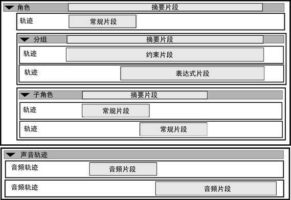

# Trax 中的非线性动画组件

在 Maya 中，以非线性方式对角色设置动画涉及处理许多不同的动画组件和动画层次级别。这些动画数据的块和层可以让您按需要自由混合、操纵、编辑和分隔角色动画为任何序列。用于管理角色非线性动画所有这些方面的工具是“Trax 编辑器”(Trax Editor)。请参见 [Trax 编辑器](../Trax%20编辑器.md)。

 <!-- baize:img-hook downloaded=true reason="正文 135 字 <300 且带图" -->
