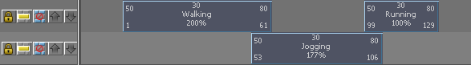

# 轨迹

 <!-- baize:img-hook downloaded=true reason="正文 284 字 <300 且带图" -->

为角色创建片段或姿势时，片段或姿势将置于其角色下的轨迹中。轨迹是轨迹视图区域中的单元格，横跨 Trax 时间轴，可以包含多个片段。场景播放时，轨迹中的片段从左到右播放。

可以使用轨迹对角色的动画序列进行对齐、分隔或分组。也可以使用按钮（“锁定”、“禁用”和“单放”）控制轨迹的状态。可以通过使用上下文菜单或通过在轨迹视图区域中向上或向下拖动片段来创建和移除轨迹。有关将轨迹添加到角色、组或子角色的信息，请参见[选择、添加和移除轨迹](../选择、添加和移除轨迹.md)。

轨迹显示在角色、组和子角色下。请参见[角色、组和子角色](角色、组和子角色.md)。Trax 中的每个角色、组或子角色都可以有多个轨迹。

## 相关主题

- [轨迹视图区域](../轨迹视图区域.md)

- [轨迹控制区域](../轨迹控制区域.md)

- [轨迹层次](../轨迹视图区域.md#GUID-42EF9259-F328-421D-823C-2571717EB564__WS17956D7ADBC6E736475032DC117AE308AAE-7F80)
