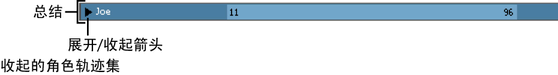

# 展开和收拢摘要轨迹

 <!-- baize:img-hook downloaded=true reason="正文 162 字 <300 且带图" -->

收拢或展开摘要轨迹

1. 在“Trax 编辑器”(Trax Editor)中，单击角色、组或子角色名称左侧的三角形箭头。

  如果收拢了摘要轨迹，则角色、组或子角色下的多个轨迹现在全都显示为一个蓝色片段和轨迹。如果将该轨迹移动到其他位置，则会移动轨迹中的所有片段。

  如果展开了摘要轨迹，则角色、组或子角色下的多个轨迹现在都显示在轨迹视图区域中。
