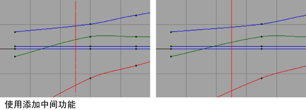
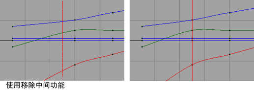

# 中间帧

中间帧提供了一种方法，通过添加或移除一帧或时间单位来调整动画计时。关键帧和受控关键点保持它们的切线特性，从而对现有动画曲线的更改减到最小程度。请参见[设置中间帧](中间帧/设置中间帧.md)。

 <!-- baize:img-hook downloaded=true reason="正文 177 字 <300 且带图" -->

 <!-- baize:img-hook downloaded=true reason="正文 177 字 <300 且带图" -->

使用“添加中间帧”(Add Inbetween)将导致动画关键帧从当前时间向前移动一个时间单位。

使用“移除中间帧”(Remove Inbetween)将导致动画关键帧从当前时间向后移动一个时间单位。
