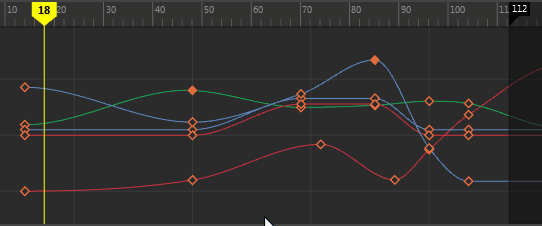

# 在“曲线图编辑器”(Graph Editor)中启用预先选择亮显

可以在图表视图中为曲线、分段、切线和关键帧启用预先选择亮显。该功能可提供有关将要选择的内容的可视反馈。

 <!-- baize:img-hook downloaded=true reason="正文 286 字 <300 且带图" -->

启用预先选择亮显

1. 在“曲线图编辑器”(Graph Editor)菜单栏中，启用“选择 > 选择前亮显”(Select > Pre-select Highlight)。

  **注**

  提示：

  可以使用

  “颜色”(Colors)

  窗口更改高光颜色。选择

  “窗口 > 设置/首选项 > 颜色设置”(Windows > Settings/Preferences > Color Settings)

  ，然后更改

  “动画编辑器”(Animation Editors)

  部分中的

  “预先选择亮显”(Pre-selection highlight)

  选项。
