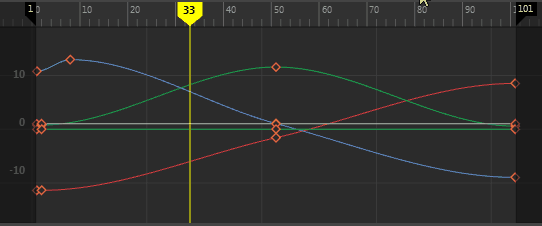

# 在曲线上移动关键帧

默认情况下，在“曲线图编辑器”(Graph Editor)中，您只需单击和拖动，便可在曲线上移动选定的关键帧。

 <!-- baize:img-hook downloaded=true reason="正文 141 字 <300 且带图" -->

**注**

提示：

若要将关键帧一次移动一帧，可按

Shift

+

9

将其向左移动，按

Shift

+

0

将其向右移动。

## 相关主题

- [“动画”(Animation)首选项（在“设置”(Settings)下）](https://beehive.autodesk.com/community/service/rest/cloudhelp/resource/cloudhelpchannel/guidcrossbook/jsonp?v=2022&p=MAYAUL&l=CHS&accessmode=live&guid=GUID-0817C74B-C95C-4E5F-BCFA-26DEE1D7747F)
