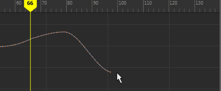

# 缩放曲线

交互式缩放曲线

1. 在“曲线图编辑器”(Graph Editor)工具栏中，选择“区域工具”(Region Tool)  <!-- baize:img-hook downloaded=true reason="正文 205 字 <300 且带图" --> 并拖动以选择要缩放的曲线区域。

  将在曲线周围显示一个矩形选择框，而且每侧都有一个操纵器控制柄。

2. 拖动整个选定框以移动整个区域，或拖动框的每侧上的控制柄以按下面的方式展开和收拢框：

  - 水平拖动，以便随着时间的推移缩短或延长区域。

  - 垂直拖动，以便增加或减小区域中值的范围。

   <!-- baize:img-hook downloaded=true reason="正文 205 字 <300 且带图" -->

  默认情况下，关键帧会捕捉到时间和值的整个值。
