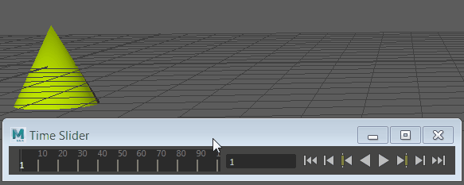

# 设定关键帧

 <!-- baize:img-hook downloaded=true reason="正文 299 字 <300 且带图" -->

移动对象，然后按“S”键在时间滑块上设置关键帧。

设置关键帧

1. 选择具有要设置关键帧的属性。

2. 选择“关键帧 > 设置关键帧”(Key > Set Key)或按 **S** 键。

  将基于[设置关键帧选项](../../动画引用/动画引用/“动画”%28Animation%29菜单集/“关键帧”%28Key%29菜单/设置关键帧选项%28Set%20Key%20Options%29.md)设置关键帧。详细信息请参见[关键帧](关键帧.md)。

**注**

提示：

每次调整时间滑块上的时间和移动对象时，您可以使用

“自动关键帧”(Auto Key)

按钮自动设置关键帧。请参见

使用自动关键帧

。

.

设置关键帧选项

1. 选择“关键帧 > 设置关键帧”(Key > Set Key) >  <!-- baize:img-hook downloaded=true reason="正文 299 字 <300 且带图" -->。

  此时将显示[“设置关键帧选项”(Set Key Options)](../../动画引用/动画引用/“动画”%28Animation%29菜单集/“关键帧”%28Key%29菜单/设置关键帧选项%28Set%20Key%20Options%29.md)窗口。

2. 设定选项。

3. 执行下列操作之一：

  - 单击“设置关键帧”(Set Key)以添加动画关键帧到对象。

  - 单击“应用”(Apply)以添加动画关键帧到对象。
