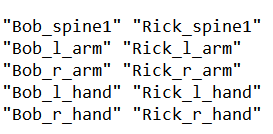

# 为 ATOM 动画导入设置贴图文件

A .*贴图*文件只是单行文本，其中的两项由空格分隔。如果 .map 文件中有多个条目，则文本类似于两列。

.map 文件中的第一列是要在 atom 文件中搜索的字符串，第二列是包含场景的替换内容的字符串。

若要创建 .map 文件，请执行以下操作：

1. 打开文本文件。

2. 输入包含要替换的内容的字符串，并用引号 ("") 括起来。例如，**"Bob_spine1"**。

3. 按空格键以输入空格，并在其后输入 **"Rick_spine1"**。这意味着 .map 文件要从 ATOM 文件中 Bob 的脊椎提取动画，并将它应用于场景中的 Rick 脊椎

  文件应类似如下：

   <!-- baize:img-hook downloaded=true reason="正文 252 字 <300 且带图" -->

  ...等。
