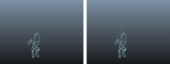

# 控制油性铅笔图像融合

默认情况下，每个油性铅笔草图的重影会在实际帧前后显示。使用一系列油性铅笔帧时，您可以调整重影图像显示，以更改图像在播放过程中的融合方式。

 <!-- baize:img-hook downloaded=true reason="正文 266 字 <300 且带图" -->

启用和禁用重影帧

1. 单击“油性铅笔”(Grease Pencil)工具中的“显示前方帧重影”(Show Pre-Frame Ghost)  <!-- baize:img-hook downloaded=true reason="正文 266 字 <300 且带图" -->和“显示后方帧重影”(Show Post-Frame Ghost)  <!-- baize:img-hook downloaded=true reason="正文 266 字 <300 且带图" -->按钮，启用或禁用所有图像的重影。

更改重影帧显示时间

1. 在重影按钮上单击鼠标右键以更改重影在当前帧前后的可见时间。

  （选择 1、2、3、4 个帧，或“其他”(Other)以输入自定义值，最大为 10。）

## 相关主题

- [油性铅笔工具](../../../../动画引用/动画引用/动画工具/“油性铅笔”%28Grease%20Pencil%29工具.md)
