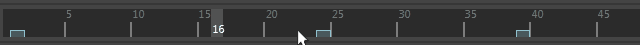

# 移动油性铅笔帧

1. 按住 Shift 键并拖动以选择一个时间范围，其中包括油性铅笔帧或“时间滑块”(Time Slider)上您要移动的帧。

  选定的区域将亮显为红色。

2. 拖动红色亮显区域中心的黄色箭头以在时间方向上拖动油性铅笔帧。

  **注**

  重要：

  - 选定区域显示的任何关键帧也将移动。

   <!-- baize:img-hook downloaded=true reason="正文 150 字 <300 且带图" -->

## 相关主题

- [使用油性铅笔在场景视图中绘制](../../使用油性铅笔在场景视图上绘制.md)

- [剪切、复制和粘贴油性铅笔帧](剪切、复制和粘贴油性铅笔帧.md)
