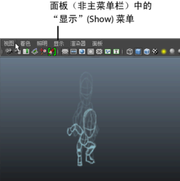

# 显示或隐藏油性铅笔草图

**注**

提示：

若要退出

“油性铅笔”(Grease Pencil)

工具，请按

Q

。

1. 在任意面板视图中选择“显示 > 油性铅笔”(Show > Grease Pencil)即可切换相应摄影机视图的油性铅笔草图的显示。

   <!-- baize:img-hook downloaded=true reason="正文 110 字 <300 且带图" -->

## 相关主题

- [清除场景中的所有油性铅笔](清除场景中的所有油性铅笔.md)
