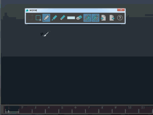
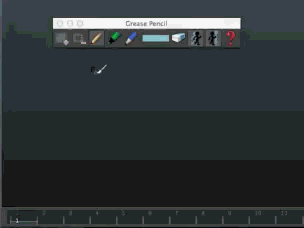

# 调整“油性铅笔”(Grease Pencil)笔刷

调整笔刷大小

1. 热键：**B + 拖动**

   <!-- baize:img-hook downloaded=true reason="正文 187 字 <300 且带图" -->

调整笔刷强度

1. 热键：**M + 拖动**

   <!-- baize:img-hook downloaded=true reason="正文 187 字 <300 且带图" -->

更改笔刷颜色

1. 单击“油性铅笔”(Grease Pencil)工具中的矩形色样  <!-- baize:img-hook downloaded=true reason="正文 187 字 <300 且带图" -->，以打开[颜色选择器](https://beehive.autodesk.com/community/service/rest/cloudhelp/resource/cloudhelpchannel/guidcrossbook/jsonp?v=2022&p=MAYAUL&l=CHS&accessmode=live&guid=GUID-B79EBC73-40D6-4D7C-B1D4-5DF5C8784914)并选择一种不同的颜色。

  **注**

  更改任何油性铅笔笔刷（

  “铅笔”(Pencil)

  、

  “记号笔”(Marker)

  或

  “软铅笔”(Soft Pencil)

  ）的颜色也会更改其他笔刷的颜色。

## 相关主题

- [使用油性铅笔在场景视图中绘制](../../使用油性铅笔在场景视图上绘制.md)

- [重置油性铅笔工具](重置“油性铅笔”%28Grease%20Pencil%29工具.md)

- [油性铅笔工具](../../../../动画引用/动画引用/动画工具/“油性铅笔”%28Grease%20Pencil%29工具.md)
