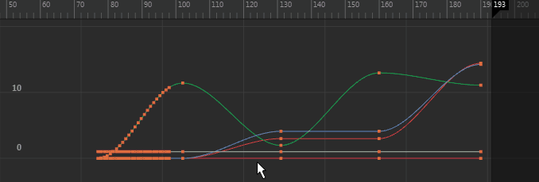

# 区域关键帧工具(Region Keys Tool)

在[“曲线图编辑器”(Graph Editor)](../../../曲线图编辑器%28Graph%20Editor%29/曲线图编辑器%28Graph%20Editor%29.md)中，单击  <!-- baize:img-hook downloaded=true reason="正文 206 字 <300 且带图" -->，或者选择“编辑 > 变换工具 > 区域关键帧工具”(Edit > Transformation Tools > Region Keys Tool)，以使用“区域关键帧工具”(Region Keys Tool)进行区域选择。

 <!-- baize:img-hook downloaded=true reason="正文 206 字 <300 且带图" -->

通过“区域关键帧工具”(Region Keys Tool)，可以在图表视图区域中拖动以选择一个区域，然后在该区域内在时间和值上缩放关键帧。

请参见[缩放关键帧](../../../关键帧动画/关键帧动画/编辑关键帧/缩放关键帧.md)或[缩放曲线](../../../关键帧动画/关键帧动画/编辑曲线/缩放曲线.md)。
