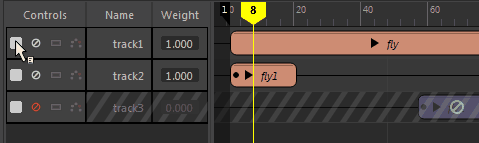
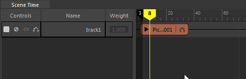

# 查看时间编辑器片段上的关键帧

您可以在片段上显示关键帧。

要显示片段的关键帧，请在轨迹的[名单控件](../时间编辑器界面概述/时间编辑器名单.md)中单击“显示关键帧”(Show Keys)图标  <!-- baize:img-hook downloaded=true reason="正文 165 字 <300 且带图" -->。

 <!-- baize:img-hook downloaded=true reason="正文 165 字 <300 且带图" -->

您也可以展开片段层次，显示每个对象上设置的关键帧。

展开片段的层次以查看每个对象上的关键帧

请单击片段名称旁边的箭头；要显示动画层次，请展开“名单”(Roster)中的每个箭头以显示层次。

 <!-- baize:img-hook downloaded=true reason="正文 165 字 <300 且带图" -->

请参见[在时间编辑器中设置动画关键帧](../在时间编辑器中设置动画关键帧.md)。
