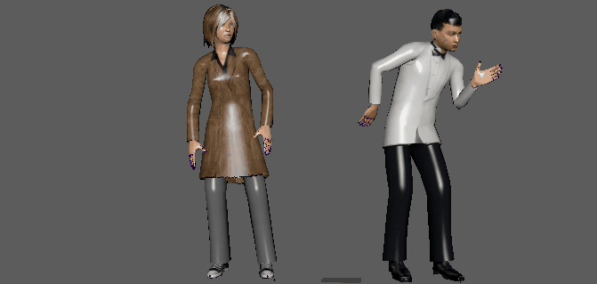

# 使用时间编辑器重映射动画

您可以使用时间编辑器将动画从一个对象重映射到另一个对象。重映射过程将获取一个对象的[动画源](使用时间编辑器片段/时间编辑器动画源.md)，然后使用它驱动另一个对象，而不将动画烘焙到任一对象。

 <!-- baize:img-hook downloaded=true reason="正文 240 字 <300 且带图" -->

若要成功将动画从一个角色重映射到另一个角色，这些角色必须具有相同的骨架层次（包括完全相同的骨骼长度），且[动画源](使用时间编辑器片段/时间编辑器动画源.md)必须先存在于场景中。

在时间编辑器中，可以通过以下两种方式重映射动画：

- 按名称空间，允许从场景中的动画源菜单中进行选择。请参见[按名称空间重映射动画](使用时间编辑器重映射动画/按名称空间重映射动画.md)。

- 将动画源从“大纲视图”(Outliner)拖动到片段上。请参见[通过动画源重映射动画](使用时间编辑器重映射动画/通过动画源重映射动画.md)。
