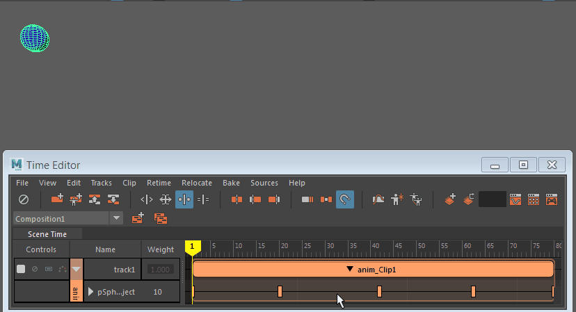

# 恢复删除的时间编辑器动画

 <!-- baize:img-hook downloaded=true reason="正文 194 字 <300 且带图" -->

如果在时间编辑器中删除了某个片段，则其动画将消失，但原始动画仍在场景中。在时间编辑器 “源”(Sources)菜单中选择“应用到场景”(Apply to Scene)，将动画恢复到场景并随即重新为对象设置动画。

**注**

也可以在

大纲视图

中找到源文件夹。

若要创建新的时间编辑器动画片段，请选择该对象，然后在[时间编辑器菜单栏](../../时间编辑器界面概述/时间编辑器菜单栏.md)中选择**“从当前选择创建片段”(Create Clip from Selection)**  <!-- baize:img-hook downloaded=true reason="正文 194 字 <300 且带图" -->。
