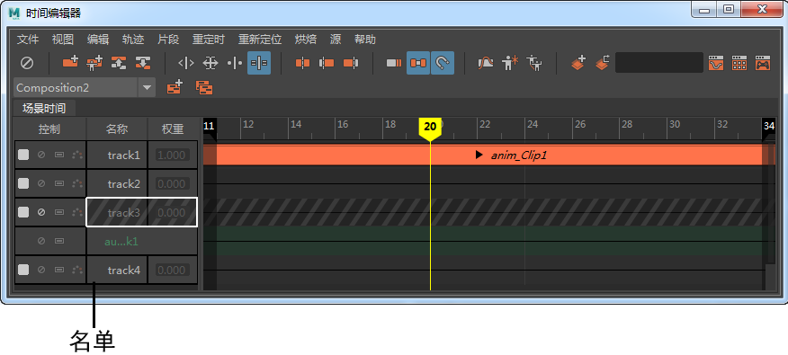

# 时间编辑器名单

 <!-- baize:img-hook downloaded=true reason="正文 250 字 <300 且带图" -->

位于时间编辑器左侧的时间编辑器名单列出了合成中的各个轨迹。

## 名单控件

您可以在时间编辑器名单中找到显示关键帧、禁用、单放、重影和加权等名单控件。这些控件以及其他操作将在[使用时间编辑器轨迹](../使用时间编辑器轨迹.md)中进行介绍。

## 轨迹权重

您可以调整片段的权重，从而控制它相对于生成的动画中其他片段的影响程度。混合权重越高，片段对动画的影响就越大。可以在每个片段的权重上设置关键帧，从而动画显示所做的更改。设置权重的动画后，将创建权重曲线，您可以像处理任何其他动画曲线一样对其进行调整。

有关详细信息，请参见[设置时间编辑器片段权重的关键帧](../在时间编辑器中设置动画关键帧/设置时间编辑器片段权重的关键帧.md)。
