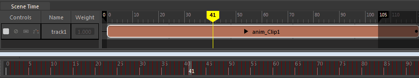
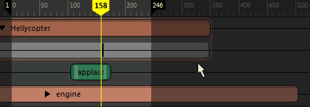

# 时间编辑器播放范围

 <!-- baize:img-hook downloaded=true reason="正文 113 字 <300 且带图" -->

时间编辑器播放范围与 Maya 的[时间滑块](https://help.autodesk.com/cloudhelp/2022/CHS/Maya-Animation/files/GUID-827ED8CD-C6AA-4495-8B5E-2FC98C8D49EE.htm)链接在一起，不同之处在于它控制时间编辑器中的播放范围。如果在时间编辑器中拖动播放范围着色，则将同时调整视口底部主时间滑块的大小。

若要调整播放范围，请沿时间标尺拖动播放范围着色（深色区域）。

 <!-- baize:img-hook downloaded=true reason="正文 113 字 <300 且带图" -->
