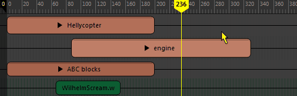
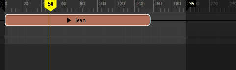

# 时间编辑器的当前时间标记

时间编辑器的当前时间标记指示视口中当前显示的帧。可以使用它在整个动画中进行拖动。

 <!-- baize:img-hook downloaded=true reason="正文 217 字 <300 且带图" -->

如果拖动时间视图，除非按 K 键并拖动，否则当前时间标记处于锁定状态。锁定当前时间标记，防止在拖动时沿轨迹意外拖动片段。

当前时间标记也用作位置标记。例如，如果要将片段一分为二，则当前时间标记将指示切割片段或被拖动的文件所处的位置。

 <!-- baize:img-hook downloaded=true reason="正文 217 字 <300 且带图" -->

可以在[颜色设置(Color Settings)](https://beehive.autodesk.com/community/service/rest/cloudhelp/resource/cloudhelpchannel/guidcrossbook/jsonp?v=2022&p=MAYAUL&l=CHS&accessmode=live&guid=GUID-1FC6CC4E-6C21-44FA-A58B-AC31ED57B591) 首选项(Preferences)中自定义当前时间标记的颜色。请参见[自定义界面的外观](https://beehive.autodesk.com/community/service/rest/cloudhelp/resource/cloudhelpchannel/guidcrossbook/jsonp?v=2022&p=MAYAUL&l=CHS&accessmode=live&guid=GUID-F17409C3-1288-46D1-A111-277615E6A956)。
