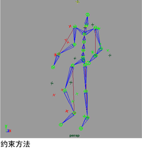

# 创建全身运动捕捉

创建全身运动捕捉序列

1. 选择一个运动捕捉设备。该设备可以是真实的或虚拟的。有关定义运动捕捉设备的信息，请参见[设置设备](设置设备.md)。

2. 选择用于计算运动的方法。

  该方法依赖于设备并可能使用反向运动学、正向运动学、约束或三者的组合。

   <!-- baize:img-hook downloaded=true reason="正文 258 字 <300 且带图" -->

3. 基于演员比例构建一个骨架。如果可能，使用运动捕捉设备数字化演员关节位置。

4. 将性能骨架附加到设备。

5. 将性能骨架连接到角色骨架。

6. 排演要记录的动作。

7. 记录该运动。

8. 查看记录的运动并将其插入到场景中。

9. 若要将运动数据插入到场景中，请选择文件 > 导入(File > Import)，然后从显示的文件浏览器中选择运动数据文件 (.mov)。
