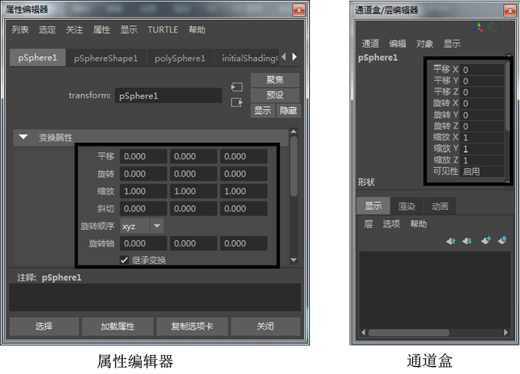

# 直接编辑组件数值

工具箱工具对于在徒手画模式下移动、缩放和变换对象很有用，但是有时您可能希望使用数值更精确地变换对象或组件。通过通道盒、属性编辑器或组件编辑器，可以完成此操作。

对于为平移、缩放和旋转变换设置特定的 X、Y 和 Z 值，通道盒和属性编辑器都是很有用的。例如，通过将平移值设置为 0, 0, 0，可以将对象快速移动回原点。

组件编辑器用于角色动画、对象变形和 nParticle 行为中的更高级操作。例如，可以精确地编辑围绕角色装备的蒙皮权重，或者微调变形器在对象上产生的效果。

 <!-- baize:img-hook downloaded=true reason="正文 272 字 <300 且带图" -->

## 相关主题

- [通道盒(Channel Box)](../../节点和属性/节点和属性/查看和编辑属性/通道盒%28Channel%20Box%29.md)

- [属性编辑器(Attribute Editor)](../../节点和属性/节点和属性/查看和编辑属性/属性编辑器%28Attribute%20Editor%29.md)

- [组件编辑器](组件编辑器%28Component%20Editor%29.md)
