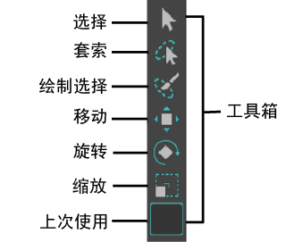

# 变换对象和组件

此部分中的主题介绍了通过精确控制或以自由方式移动、旋转和缩放对象和组件的多种不同方式。

变换对象将在场景内移动对象，而变换组件通常会更改这些对象的形状。有关变换组件的具体详细信息，请参见[变换多边形组件](https://beehive.autodesk.com/community/service/rest/cloudhelp/resource/cloudhelpchannel/guidcrossbook/jsonp?v=2022&p=MAYAUL&l=CHS&accessmode=live&guid=GUID-6041BD1C-A129-444A-8737-F6EB65CA6246)。

可以在 Maya 窗口左侧的工具箱中找到移动、旋转和缩放工具。

 <!-- baize:img-hook downloaded=true reason="正文 140 字 <300 且带图" -->

## 相关主题

- [变换多边形组件](https://beehive.autodesk.com/community/service/rest/cloudhelp/resource/cloudhelpchannel/guidcrossbook/jsonp?v=2022&p=MAYAUL&l=CHS&accessmode=live&guid=GUID-6041BD1C-A129-444A-8737-F6EB65CA6246)
