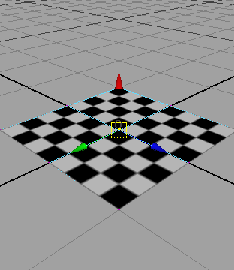
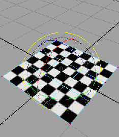
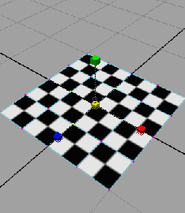
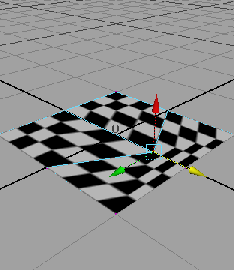
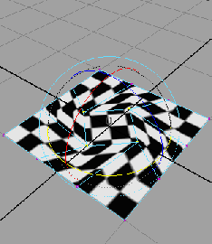
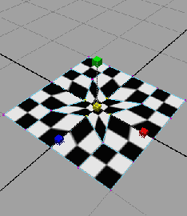
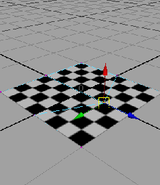
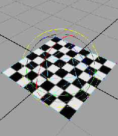
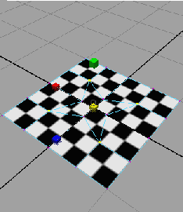

# 在变换期间保留纹理

当变换对象顶点时 UV 不会默认移入 UV 空间中。因此，对象的纹理可能会变得扭曲。要避免出现这种情况，请在“工具设置编辑器”(Tool Settings Editor)中针对正在使用的任何变换工具启用“保持 UV”(Preserve UVs)选项。

| 保持 UV | 平移 | 旋转 | 缩放 |
|---|---|---|---|
| 之前 |  <!-- baize:img-hook downloaded=true reason="正文 191 字 <300 且带图" --> |  <!-- baize:img-hook downloaded=true reason="正文 191 字 <300 且带图" --> |  <!-- baize:img-hook downloaded=true reason="正文 191 字 <300 且带图" --> |
| 关闭 |  <!-- baize:img-hook downloaded=true reason="正文 191 字 <300 且带图" --> |  <!-- baize:img-hook downloaded=true reason="正文 191 字 <300 且带图" --> |  <!-- baize:img-hook downloaded=true reason="正文 191 字 <300 且带图" --> |
| 打开 |  <!-- baize:img-hook downloaded=true reason="正文 191 字 <300 且带图" --> |  <!-- baize:img-hook downloaded=true reason="正文 191 字 <300 且带图" --> |  <!-- baize:img-hook downloaded=true reason="正文 191 字 <300 且带图" --> |

通过启用此选项，相对于在场景视图中发生的变换，Maya 在 UV 空间中自动变换 UV。

## 相关主题

- [映射 UV](https://beehive.autodesk.com/community/service/rest/cloudhelp/resource/cloudhelpchannel/guidcrossbook/jsonp?v=2022&p=MAYAUL&l=CHS&accessmode=live&guid=GUID-F5882F28-2430-4D17-9C30-77B0390727AE)

- [移动、旋转和缩放 UV](https://beehive.autodesk.com/community/service/rest/cloudhelp/resource/cloudhelpchannel/guidcrossbook/jsonp?v=2022&p=MAYAUL&l=CHS&accessmode=live&guid=GUID-D8C69233-0D3D-46BC-A6B5-E8936B157D56)
