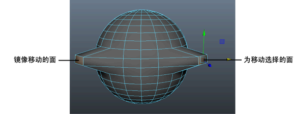

# 对称地变换组件

当使用变换工具编辑模型时，“对称设置”(Symmetry Settings)用于进行对称更改。

 <!-- baize:img-hook downloaded=true reason="正文 285 字 <300 且带图" -->

对称地变换组件

1. [激活对称](https://beehive.autodesk.com/community/service/rest/cloudhelp/resource/cloudhelpchannel/guidcrossbook/jsonp?v=2022&p=MAYAUL&l=CHS&accessmode=live&guid=GUID-7EC940BA-4B3A-4DB2-AC6B-8CDBA800EC61)。

2. 在网格的某一半上选择要移动、旋转或缩放的组件。

  **注**

  提示：

  您可以先高亮显示组件，然后再实际选择它们。当移动光标靠近组件时，最近的组件上会显示彩色亮显。请参见

  选择组件前亮显组件

  。

  变换操纵器会捕捉到当前选择，网格另一侧上的组件也会被选中。

  **注**

  您也可以在

  “工具设置”(Tool Settings)

  中启用

  “软选择”(Soft Selection)

  ，以快速扩展您的选择。

3. 移动、旋转或缩放所选的组件。

  对象另一侧上的对应组件也会进行变换。

## 相关主题

- [对称编辑](https://beehive.autodesk.com/community/service/rest/cloudhelp/resource/cloudhelpchannel/guidcrossbook/jsonp?v=2022&p=MAYAUL&l=CHS&accessmode=live&guid=GUID-68206E61-CFF0-4C83-9254-B761C51FED98)

- [移动工具](../../../界面概述/界面概述/工具箱%28Tool%20Box%29/移动工具%28Move%20Tool%29.md)

- [旋转工具](../../../界面概述/界面概述/工具箱%28Tool%20Box%29/旋转工具%28Rotate%20Tool%29.md)

- [缩放工具](../../../界面概述/界面概述/工具箱%28Tool%20Box%29/缩放工具%28Scale%20Tool%29.md)
