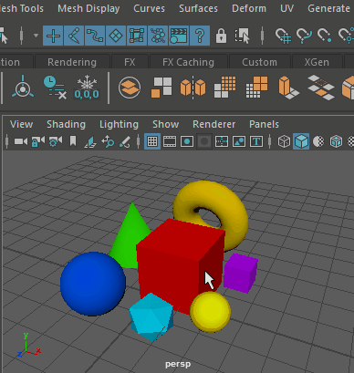

# 将操纵器锁定到当前选择

您可以为选定对象设置操纵，以便在该对象附近单击时对其进行操纵，而不是直接选择它。

 <!-- baize:img-hook downloaded=true reason="正文 290 字 <300 且带图" -->

1. 选择对象。

2. 选择“移动”(Move)、“旋转”(Rotate)、“缩放”(Scale)或“显示操纵器工具”(Show Manipulator Tool)。

3. 单击[“状态行”(Status Line)（工具栏）](../../../界面概述/界面概述/状态行（工具栏）.md)中的“锁定当前选择”(Lock current selection)  <!-- baize:img-hook downloaded=true reason="正文 290 字 <300 且带图" -->图标。

  启用锁定图标时，无法使用此工具选择其他对象。单击或拖动鼠标左键即可对活动的操纵器控制柄进行操作（与通常情况下使用鼠标中键进行操作的效果相同）。

  再次单击“锁定当前选择”(Lock current selection)图标即可解除锁定操纵器。
