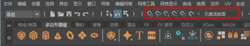

# 捕捉到栅格、曲线、点、视图平面或几何体中心

使用“移动工具”(Move Tool)和各种创建工具时，可以捕捉到场景中的现有对象。

 <!-- baize:img-hook downloaded=true reason="正文 192 字 <300 且带图" -->

若要捕捉移动，请在要捕捉到的对象上单击鼠标中键：

| 捕捉到... | 按住 | 或在状态行（工具栏）上启用该图标 |
|---|---|---|
| 栅格交点 | x |  <!-- baize:img-hook downloaded=true reason="正文 192 字 <300 且带图" --> |
| 曲线 | c |  <!-- baize:img-hook downloaded=true reason="正文 192 字 <300 且带图" --> |
| CV、顶点或轴 | v |  <!-- baize:img-hook downloaded=true reason="正文 192 字 <300 且带图" --> |
| 几何体中心 |  |  <!-- baize:img-hook downloaded=true reason="正文 192 字 <300 且带图" --> |
| 视图平面 |  |  <!-- baize:img-hook downloaded=true reason="正文 192 字 <300 且带图" --> |
| 曲面 |  |  <!-- baize:img-hook downloaded=true reason="正文 192 字 <300 且带图" --> |

**注**

如果已启用捕捉并在

“移动”(Move)

操纵器上拖动箭头（相对于中心），则操纵器将沿该轴捕捉到第一个可用的点。

## 相关主题

- [捕捉到激活的曲面](捕捉到激活的曲面.md)

- [创建关节或关节链](https://beehive.autodesk.com/community/service/rest/cloudhelp/resource/cloudhelpchannel/guidcrossbook/jsonp?v=2022&p=MAYAUL&l=CHS&accessmode=live&guid=GUID-142CB5D5-5609-4D23-B40E-F26FB08A55AB)
