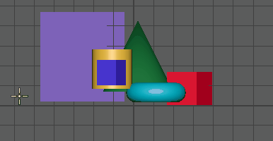

# 计算两点之间的距离

1. 选择创建 > 测量工具 > 距离工具(Create > Measure Tools > Distance Tool)。

2. 单击正交栅格视图上的两个点或按住 **V** 键以激活顶点捕捉，然后单击两个多边形顶点。

  Maya 会创建两个定位器以及一个距离度量。可以选择和移动定位器以编辑度量。

   <!-- baize:img-hook downloaded=true reason="正文 273 字 <300 且带图" -->

  **注**

  默认度量单位为厘米。可以在

  设置首选项

  （

  “窗口 > 设置/首选项 > 设置”(Windows > Settings/Preferences > Settings)

  ）的“工作单位”(Working Units)部分中设置其他单位。

  如果将度量定位器捕捉至对象，定位器会随对象移动。

## 相关主题

- [在曲线或曲面上显示参数或弧长值](在曲线或曲面上显示参数或弧长值.md)
