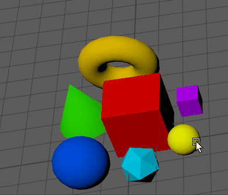
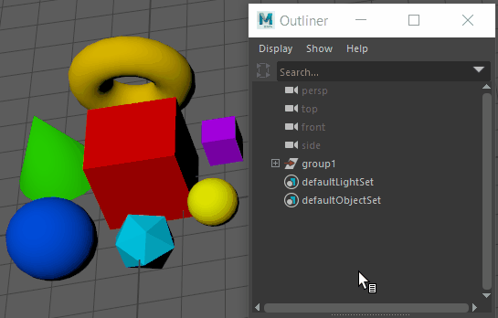

# 将对象分组

将对象分组时，可以将组作为单一单位选择、移动、旋转和缩放。

 <!-- baize:img-hook downloaded=true reason="正文 279 字 <300 且带图" -->

按 Ctrl + G 将对象分组到一起

| 目标 | 操作 |
|---|---|
| 将选定对象分组到一起。 | 选择“编辑 > 分组”(Edit > Group)或按 **Ctrl** + **G**。 有关详细信息，请参见[“分组”(Group)选项](../../../基本参考/基本参考/主菜单/“编辑”%28Edit%29菜单/“组”%28Group%29选项.md)。 |
| 对选定组进行解组。 | 选择“编辑 > 解组”(Edit > Ungroup)。有关详细信息，请参见[“解组”(Ungroup)选项](../../../基本参考/基本参考/主菜单/“编辑”%28Edit%29菜单/“解组”%28Ungroup%29选项.md)。 |
| 选择组中的对象。 | 打开[大纲视图(Outliner)](../../../节点和属性/节点和属性/大纲视图%28Outliner%29.md)，展开组节点以显示组内对象，然后单击要选择的对象。  <!-- baize:img-hook downloaded=true reason="正文 279 字 <300 且带图" --> |

依据场景层级，**“分组”(Group)**命令对新变换节点下的选定对象进行移动。

## 相关主题

- [变换对象](../../../变换对象/变换对象.md)

- [场景层次](../../../节点和属性/节点和属性/场景层次.md)

- [查看和编辑节点层次](../../../节点和属性/节点和属性/编辑节点层次.md)
