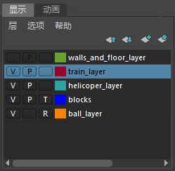

# 组织显示层中的对象

如果场景是通过使用[显示层编辑器](组织显示层中的对象/显示层编辑器.md)由不同层中的对象组成的，则可对场景的相关元素进行组织，同时可选择元素在 3D 视图中是否可见并将其设置为是否可选。

通过启用或禁用层的可见性，可仅在需要时才在 3D 视图中看到这些对象。同样，您可以仅在动画播放期间隐藏层中的对象，这样可以加快播放速度。

通过使用层，您还可以对给定层中的所有对象进行模板化或引用，使其不可选。这样可以防止意外选择或更改其中任一对象。

 <!-- baize:img-hook downloaded=true reason="正文 204 字 <300 且带图" -->

## 相关主题

- [动画层](https://beehive.autodesk.com/community/service/rest/cloudhelp/resource/cloudhelpchannel/guidcrossbook/jsonp?v=2022&p=MAYAUL&l=CHS&accessmode=live&guid=GUID-5C202CB8-EB3C-4ADE-B203-5F93A9FD9104)

- [使对象不可选](../../../选择/选择/使对象不可选（模板）.md)
