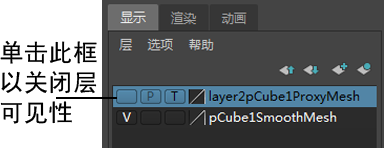

# 隐藏显示层

可以切换显示层的可见性以控制对象是否在 3D 视图中显示。

也可以切换显示层可见性，以便仅在播放期间隐藏对象。在播放动画时隐藏不重要的对象可以提高播放性能。例如，将角色的控制装备对象设置为在播放期间隐藏。当您处理动画时装备是可见的，而当您按下播放时则不可见，以便它不会降低播放性能。

隐藏显示层

1. 在显示层编辑器中，单击层名称旁边第一列中的“V”，以切换该层上对象的可见性。

   <!-- baize:img-hook downloaded=true reason="正文 288 字 <300 且带图" -->

仅在播放期间隐藏显示层

1. 单击层名称旁边第二列中的“P”。

  在您工作时，层上的对象在场景视图中保持可见，而在播放期间则变为不可见。

  **注**

  隐藏显示层在回放期间仅适用于 Viewport 2.0。请参见

  关于 Viewport 2.0。
