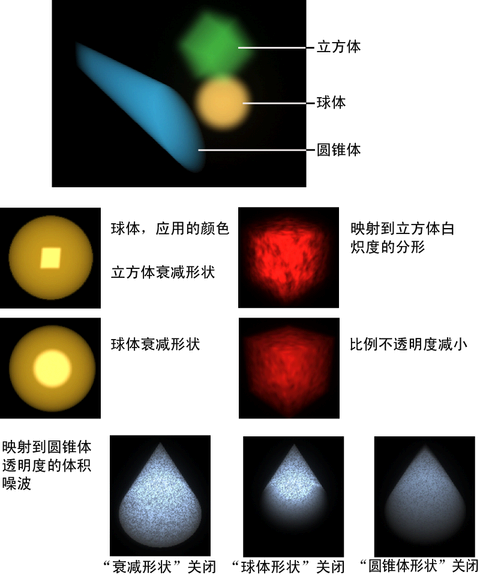

# “体积基本体”(Volume primitives)选项

可以将“体积基本体”(Volume Primitives)与灯光和“体积雾”(Volume Fog)结合使用来生成有雾的大气体积效果。另请参见[体积雾](https://beehive.autodesk.com/community/service/rest/cloudhelp/resource/cloudhelpchannel/guidcrossbook/jsonp?v=2022&p=MAYAUL&l=CHS&accessmode=live&guid=GUID-797DD5EF-4CC0-44D1-A5F7-C891B3009AFF)。

 <!-- baize:img-hook downloaded=true reason="正文 73 字 <300 且带图" -->
