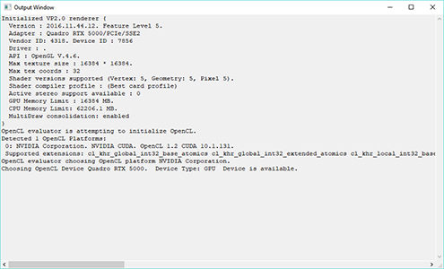

# 输出窗口(Output Window)

 <!-- baize:img-hook downloaded=true reason="正文 258 字 <300 且带图" -->

“输出窗口”(Output Window)是一个附加控制台，可在 Windows 中随 Maya 一起运行以提供各种诊断和状态更新（特别是 stdout 和 stderr 输出）。执行某些计算量较大的运算时，Maya 可能会将进度更新发送到控制台（而非主用户界面）。因此，如果界面看起来已冻结，请检查“输出窗口”(Output Window)以查看是否正在其中发送更新。

 <!-- baize:img-hook downloaded=true reason="正文 258 字 <300 且带图" -->

可以通过“窗口 > 输出窗口”(Windows > Output Window)打开“输出窗口”(Output Window)。还可以使用 outputWindow 命令显示/隐藏它。
