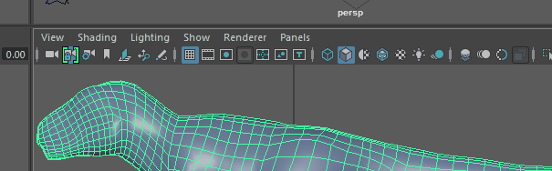
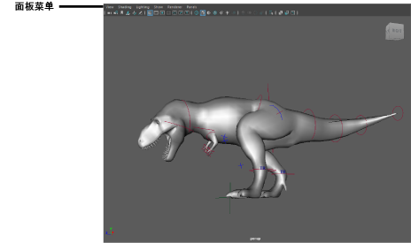
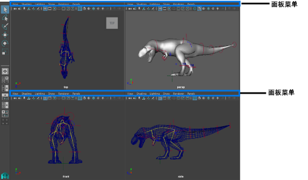

# 面板菜单

显示或隐藏面板菜单

- 按 Shift+M 可启用或禁用面板菜单。

   <!-- baize:img-hook downloaded=true reason="正文 84 字 <300 且带图" -->

面板菜单将在场景视图之上显示。

 <!-- baize:img-hook downloaded=true reason="正文 84 字 <300 且带图" -->

处理具有多个视图面板的布局时，菜单可用于每个视图窗格，并允许您调整每个面板的选项。

 <!-- baize:img-hook downloaded=true reason="正文 84 字 <300 且带图" -->
