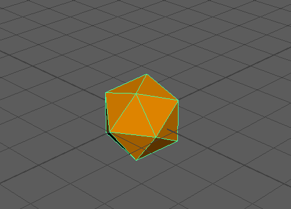

# 调整操纵器大小

如果要使“移动”(Move)  <!-- baize:img-hook downloaded=true reason="正文 117 字 <300 且带图" -->、“旋转”(Rotate)  <!-- baize:img-hook downloaded=true reason="正文 117 字 <300 且带图" --> 或“缩放”(Scale)  <!-- baize:img-hook downloaded=true reason="正文 117 字 <300 且带图" --> 工具操纵器变小或变大，可以使用加号 (+) 和减号 (-) 键来扩大和收缩。

 <!-- baize:img-hook downloaded=true reason="正文 117 字 <300 且带图" -->

按加号 (+) 和减号 (-) 键来更改操纵器大小

**注**

工具必须处于活动状态（移动、旋转、缩放）。
