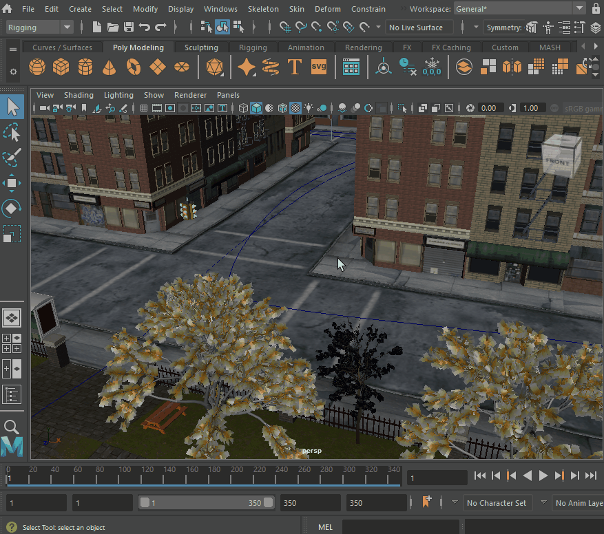

# 进入全屏模式 (Windows)

 <!-- baize:img-hook downloaded=true reason="正文 272 字 <300 且带图" -->

按 Ctrl+Shift 切换到全屏模式

全屏模式可以最大化 Maya 的工作区，从而使 Maya 在更小的屏幕上更易于使用。启用了全屏模式后，标题栏、菜单栏以及固定窗口都将被隐藏。

**注**

如果您使用的是 Mac OS，则此步骤会有所不同。若要在 Mac 上进入全屏模式，请参见

进入全屏模式 (macOS)

。

在 Windows 上进入全屏模式

在 Maya 中，按 **Ctrl**+**空格键**以在当前[视图面板(View panels)](../../界面概述/界面概述/视图面板.md)的默认视图和全屏视图之间切换。

在 Windows 上退出全屏模式

再次按 **Ctrl**+**空格键**。

**注**

提示：

若要显示或隐藏

视图面板(View panels)

菜单，请按

Shift

+

M

。
