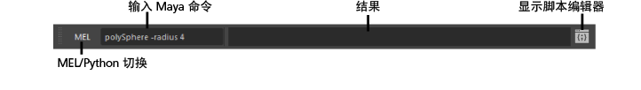

# 命令行(Command line)

可以在命令行中键入单个 MEL 或 Python 命令，而无需打开脚本编辑器。单击“MEL”/“Python”按钮可在 MEL 和 Python 模式之间切换。命令的结果显示在输出中

 <!-- baize:img-hook downloaded=true reason="正文 238 字 <300 且带图" -->

在命令行中键入 MEL 或 Python 命令。结果显示在命令行右侧的彩色框中。您可以拖动输入框与结果框之间的分隔线来重新调整二者的大小。当光标位于命令行中时，使用上箭头键和下箭头键可浏览命令历史。

若要输入多个复杂脚本，请单击结果框右侧的“脚本编辑器”(Script Editor)按钮。有关详细信息，请参见[脚本编辑器](https://beehive.autodesk.com/community/service/rest/cloudhelp/resource/cloudhelpchannel/guidcrossbook/jsonp?v=2022&p=MAYAUL&l=CHS&accessmode=live&guid=GUID-7C861047-C7E0-4780-ACB5-752CD22AB02E)。
