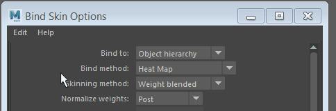
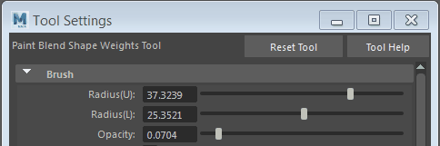

# 设置或重置工具或菜单项的选项

许多工具都有一些选项在菜单中显示为框  <!-- baize:img-hook downloaded=true reason="正文 234 字 <300 且带图" -->。此选项框可用于调整每个工具的各个设置。

- 单击菜单项名称旁的  <!-- baize:img-hook downloaded=true reason="正文 234 字 <300 且带图" --> 框以打开该操作的选项窗口。

- 双击工具以显示[“工具设置”(Tool Settings)](../工具设置%28Tool%20Settings%29.md)面板。

将工具或操作重置为其初始（“出厂”）选项

可以通过单击**“重置”(Reset)**将菜单项恢复为其默认设置。

执行下列操作之一：

- 在选项窗口中，选择“编辑 > 重置设置”(Edit > Reset settings)。

   <!-- baize:img-hook downloaded=true reason="正文 234 字 <300 且带图" -->

- 在“工具设置”(Tool Settings)编辑器中，单击“重置工具”(Reset Tool)。

   <!-- baize:img-hook downloaded=true reason="正文 234 字 <300 且带图" -->
