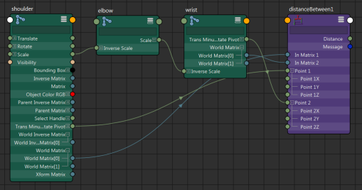
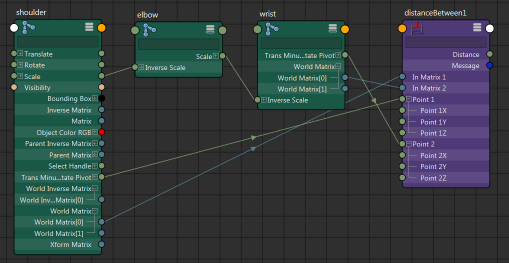
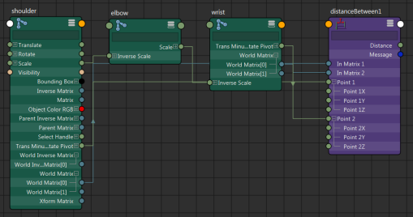
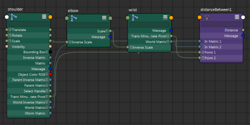

# 选择不同的连接线样式

默认情况下，连接线绘制为曲线 (Bezier) 样式。或者，您可以选择将连接线显示为直线、草图线（带角点的线）或 S 形线。您可从“显示 > 连接样式”(Display > Connection Style)菜单中的各种选项进行选择。

**注**

此选项也会影响

Hypershade

工作区中的连接线样式。

Bezier（默认值）：

 <!-- baize:img-hook downloaded=true reason="正文 195 字 <300 且带图" -->

直线(Straight lines)：

 <!-- baize:img-hook downloaded=true reason="正文 195 字 <300 且带图" -->

角线(Corner lines)：

 <!-- baize:img-hook downloaded=true reason="正文 195 字 <300 且带图" -->

S 形(S-Shape)

 <!-- baize:img-hook downloaded=true reason="正文 195 字 <300 且带图" -->
