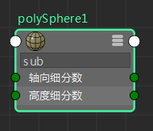

# “节点编辑器”(Node Editor)中的属性过滤

使用“节点编辑器”(Node Editor)中样例下方的过滤器字段来过滤属性。例如，如果要分离出与颜色相关的属性，请键入“col”，系统将仅显示包含字母“col”的属性。

可以通过输入属性长名称或其 UI 名称进行过滤，例如“轴向细分数”或 subdivisionsAxis。

若要在显示和隐藏过滤器字段之间切换，请单击工具栏中的  <!-- baize:img-hook downloaded=true reason="正文 281 字 <300 且带图" -->。在自定义模式（模式 4）下，默认情况下禁用过滤器字段。单击  <!-- baize:img-hook downloaded=true reason="正文 281 字 <300 且带图" --> 可显示它。

**注**

也可以使用热键 s 在显示和隐藏过滤器字段之间切换。此热键仅适用于

节点编辑器

，而不适用于

Hypershade

。

 <!-- baize:img-hook downloaded=true reason="正文 281 字 <300 且带图" -->

**注**

由于过滤，系统将绘制与隐藏属性的连接，而不绘制与主端口的连接。
