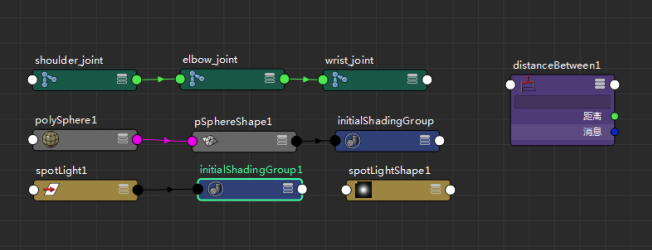
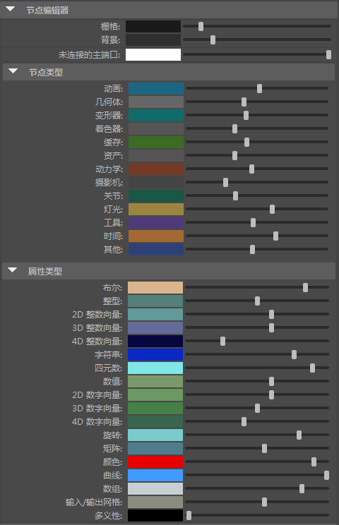

# “节点编辑器”(Node Editor)中的节点颜色

为方便识别，不同节点类型以不同颜色着色。例如，动画节点是浅蓝色、关节是绿色、灯光是米黄色。

 <!-- baize:img-hook downloaded=true reason="正文 291 字 <300 且带图" -->

若要查看列表或更改节点颜色，请打开“节点编辑器”(Node Editor)，选择[颜色设置(Color Settings)](https://beehive.autodesk.com/community/service/rest/cloudhelp/resource/cloudhelpchannel/guidcrossbook/jsonp?v=2022&p=MAYAUL&l=CHS&accessmode=live&guid=GUID-1FC6CC4E-6C21-44FA-A58B-AC31ED57B591)。在“常规”(General)选项卡上，展开“节点编辑器”(Node Editor)区域，再展开“节点类型”(Node Types)区域，可以看到用于每个节点类型的默认颜色的列表。您可以单击颜色样本，使用 “颜色选择器”(Color Chooser)选择一种颜色来自定义每个节点类型的颜色。

 <!-- baize:img-hook downloaded=true reason="正文 291 字 <300 且带图" -->

“颜色设置”(Color Settings)中的“节点编辑器”(Node Editor)颜色列表。
