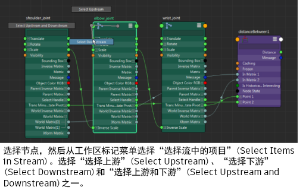

# 在节点编辑器或 Hypershade 中选择上游和/或下游节点

以下工作流同时适用于节点编辑器和 Hypershade。

1. 选择要为其选择上游和/或下游节点的节点。在工作区中单击鼠标右键以访问标记菜单。

2. 选择“选择流中的项目”(Select Items in Stream)，然后从“选择上游”(Select Upstream)、“选择下游”(Select Downstream)和“选择上游和下游”(Select Upstream and Downstream)中选择一项。

将在“节点编辑器”(Node Editor)中选择上游和/或下游节点。

**注**

提示：

也可以使用热键，或分别选择选定节点的上游或下游节点。若要同时选择上游和下游节点，请使用快捷键 /。

 <!-- baize:img-hook downloaded=true reason="正文 279 字 <300 且带图" -->
