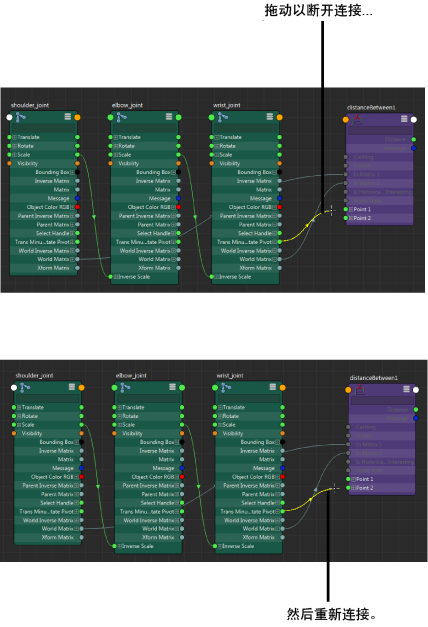

# 更改现有的节点属性连接

以下工作流同时适用于节点编辑器和 Hypershade。

可以拖动连接线以断开并重新创建连接。

将输出重新连接到其他输入

1. 从输入侧拖动连接线以断开连接，然后将其重新连接到其他输入。

   <!-- baize:img-hook downloaded=true reason="正文 127 字 <300 且带图" -->

将输入重新连接到其他输出

1. 从输出侧拖动连接线以断开连接，然后将其重新连接到其他输出。
