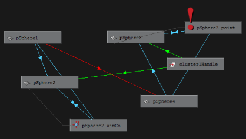
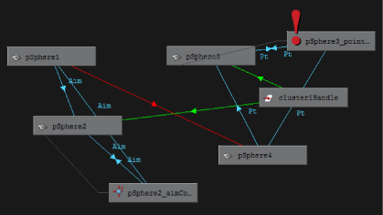

# 在 Hypergraph 中显示连接

在 Hypergraph 中显示连接

1. 确保在 [Hypershade“选项”(Options)菜单](https://beehive.autodesk.com/community/service/rest/cloudhelp/resource/cloudhelpchannel/guidcrossbook/jsonp?v=2022&p=MAYAUL&l=CHS&accessmode=live&guid=GUID-22E42E1C-9CFD-4D17-BF35-1281BCE5FBB3)中启用了场景中的连接类型（约束、变形器、表达式）。

2. 选择“选项 > 显示 > 过滤器”(Options > Display > Filter Connections)，然后选择一个连接过滤器。

  连接的节点之间会显示线，并且箭头将指示连接的方向。

   <!-- baize:img-hook downloaded=true reason="正文 293 字 <300 且带图" -->

3. （可选）从 [Hypergraph 标记菜单](../“Hypergraph”概述/Hypergraph%20菜单/Hypergraph%20标记菜单.md)（按住 Shift 键并单击鼠标右键）中选择“切换连接标签”(Toggle Connection Label)，以显示约束连接的标签。

  每条连接线上方会显示标签，指示约束连接的类型。

   <!-- baize:img-hook downloaded=true reason="正文 293 字 <300 且带图" -->

**注**

只有约束连接显示连接标签。

## 相关主题

- [“Hypergraph”概述](../“Hypergraph”概述.md)
