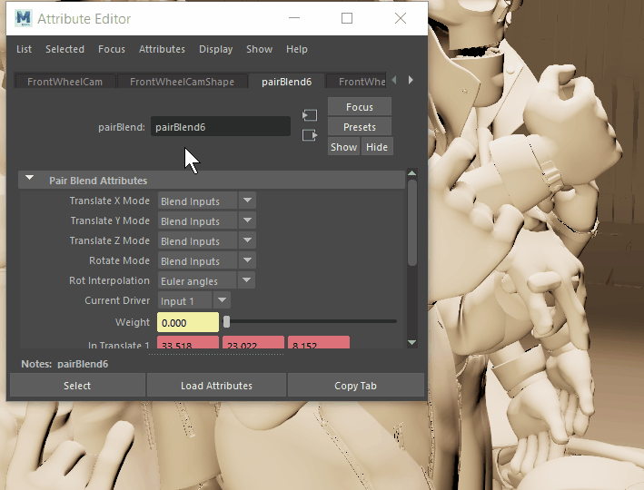

# 打开多个“属性编辑器”(Attribute Editor)

 <!-- baize:img-hook downloaded=true reason="正文 160 字 <300 且带图" -->

1. 打开[“属性编辑器”(Attribute Editor)](../属性编辑器%28Attribute%20Editor%29.md)。

2. 选择第一个对象。

3. 在“属性编辑器”(Attribute Editor)中，单击“复制”(Copy)选项卡。系统将显示新的“属性编辑器”(Attribute Editor)并加载对象属性。

4. 选择另一个对象。其属性将加载到原始“属性编辑器”(Attribute Editor)中。
