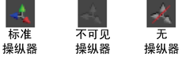

# 显示或隐藏“通道盒”(Channel Box)中属性的操纵器

通常，单击属性名称时，选定的对象上将显示操纵器，用于控制该属性，此外还可以使用鼠标中键拖动来更改该属性的值。可以禁用操纵器和拖动功能。

 <!-- baize:img-hook downloaded=true reason="正文 259 字 <300 且带图" -->

| 目标 | 在通道盒中选择 |
|---|---|
| 防止在单击属性名称时显示操纵器。 | 编辑 > 设置 > 不可见操纵器(Edit > Settings > Invisible Manips)。 |
| 防止显示操纵器并禁用鼠标中键拖动功能。 | 编辑 > 设置 > 无操纵器(Edit > Settings > No Manips)。 |
| 在单击属性名称时显示操纵器并允许使用鼠标中键拖动功能。 | 编辑 > 设置 > 标准操纵器(Edit > Settings > Standard Manips)。 |
