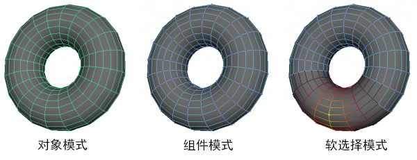

# 选择

Maya 中选择方面的基础知识涉及设置所需的[“选择模式”(Selection mode)](选择/选择模式.md)以及使用[“选择工具”(Select Tool)](../界面概述/界面概述/工具箱%28Tool%20Box%29/选择工具%28Select%20Tool%29.md)。

 <!-- baize:img-hook downloaded=true reason="正文 65 字 <300 且带图" -->
