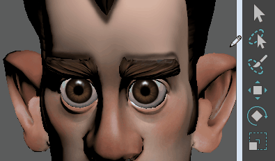

# 通过绘制选择组件

可通过使用图形触笔在所需组件上绘制来选择组件，例如顶点或面。

 <!-- baize:img-hook downloaded=true reason="正文 244 字 <300 且带图" -->

1. 选择要选择其上的组件的对象。

2. 双击工具箱  <!-- baize:img-hook downloaded=true reason="正文 244 字 <300 且带图" -->中的“绘制选择工具”(Paint Selection Tool)。

3. 使用“工具设置”(Tool Settings)面板可以设置工具，包括笔刷大小和选择是要选择、取消选择还是在选定和取消选定之间切换组件。

4. 设置选择遮罩来选择所需的组件类型。

5. 在选定对象上绘制来选择组件。

**注**

也可以使用

“拖动选择”(Drag Select)

选项来获得类似的工作流，但没有笔刷大小。有关拖动选择的详细信息，请参见

选择多个组件

。
