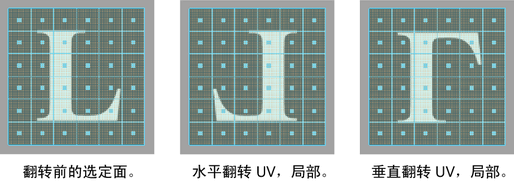
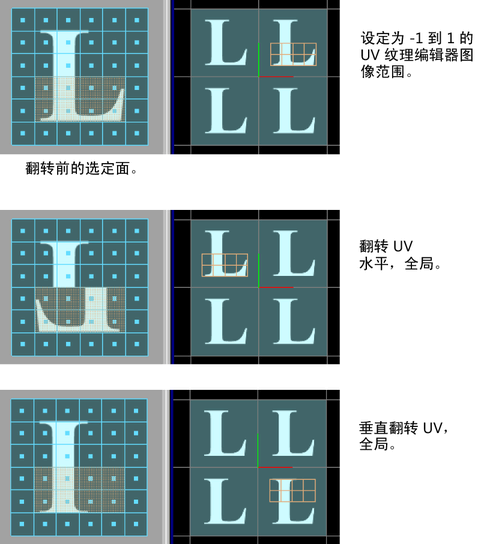

# 翻转 UV 选项(Flip UVs options)

使用这些选项可设置在选择“UV > 翻转”(UV > Flip)时发生的情况。

## 设置

#### 方向(Direction)

设定选定壳的 UV 的翻转方向：“水平”(Horizontal)或“垂直”(Vertical)。默认为“水平”(Horizontal)。

#### 坐标(Coordinate)

根据需要设定“全局”(Global)以在 0 到 1 的纹理空间轴中的全局 UV 空间内翻转 UV 壳。选择“局部”(Local)以在选定壳的边界框内翻转 UV。默认为“局部”(Local)。

 <!-- baize:img-hook downloaded=true reason="正文 251 字 <300 且带图" -->

 <!-- baize:img-hook downloaded=true reason="正文 251 字 <300 且带图" -->

#### 切割 UV 周长(Cut UV Perimeter)

## 相关主题

- [翻转或旋转 UV 壳](../../../../../编辑%20UV/翻转%20UV%20壳.md)
