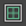

# 在 UV 编辑器内推拉或平移

| 目标 | 操作 |
|---|---|
| 更改 UV 的视图。 | 使用摄影机移动关键帧： Alt + 鼠标中键：平移 Alt + 鼠标右键：推摄和拉摄 |
| 放大/缩小以显示全部 UV。 | 在“UV 编辑器”(UV Editor)中，选择“视图 > 框显全部”(View > Frame All)。 |
| 放大/缩小以显示选定的 UV。 | 在“UV 编辑器”(UV Editor)中，选择“视图 > 框显当前选择”(View > Frame Selection)。 |
| 使纹理边界看起来显得更粗。 | 在 UV 编辑器中，单击“切换纹理边界”(Toggle Texture Borders)按钮。  <!-- baize:img-hook downloaded=true reason="正文 254 字 <300 且带图" --> |

## 相关主题

- [显示 UV 后面的纹理](../../../显示和选择%20UV/显示%20UV%20后面的纹理.md)

- [分离和附加 UV 壳](../../../编辑%20UV/分离和附加%20UV.md)
